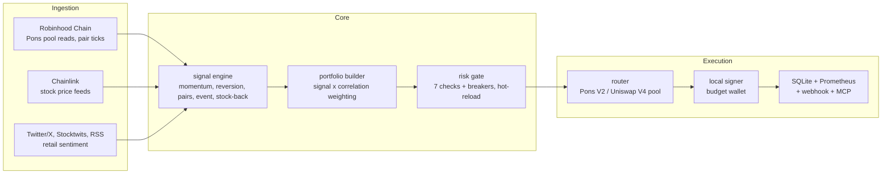

<div align="center">


# PIP


</div>

<br>

> agentic trading for [ponsfamily.com](https://ponsfamily.com) &nbsp;|&nbsp; RWA token-stock pairs &nbsp;|&nbsp; Robinhood Chain

PIP (Pons Investment Pilot) is the trading agent behind pons.family. It watches the Pons pair
pools on Robinhood Chain, the Chainlink feeds for the stocks those pairs are
tied to, and what Robinhood retail is saying about them, then sizes a book,
runs every order through a risk gate, and swaps on-chain from a wallet you
fund for it and nothing else.

It runs in paper mode until you hand it a key. It stops when you tell it to.
It does not resume on its own after a loss.

PIP: [ponsfamily.com/pip](https://www.ponsfamily.com/pip) &nbsp;|&nbsp; Site: [ponsfamily.com](https://ponsfamily.com) &nbsp;|&nbsp; X: [@ponsdotfamily](https://x.com/ponsdotfamily)

---

## Status

```
+----------------------------------------------------------+
|  chain     Robinhood Chain (ID 4663)                     |
|  wallet    dedicated budget wallet, set in .env          |
|  mode      PAPER by default, LIVE needs a key + router   |
|  session   09:30 to 16:00 ET for stock feeds, tokens 24/7|
|  asset     Pons token / tokenized stock pairs (V2 pools) |
|  rpc       rpc.mainnet.chain.robinhood.com               |
|  metrics   127.0.0.1:8000/metrics                        |
|  mcp       127.0.0.1:8765/mcp (bearer secret)            |
+----------------------------------------------------------+
```

The router address, the Chainlink feed map, and the USDG address are blank in
`config/pons.yaml` until they are confirmed against ponsfamily.com. A blank
router keeps the agent unarmed even if a key is present.

---

## How it works

One process, one event loop, six event types. Each stage is a handler on the
bus and the bus drains between stages, so every signal is seen before any
order is built and every order is judged before any fill exists.



Strategies get a frozen copy of the book and return signals. They cannot
place orders. The portfolio builder turns signals into orders, the gate says
PASS, REDUCE, or BLOCK, and the router re-checks the gate's answer at the
moment of submission before anything is signed.

---

## The stock-back edge

On a Pons token-stock pair the trading-fee cashback is paid in the tokenized
stock, not in cash. Hold the pair and you accrue the underlying at a rate set
by the pair's fee flow:

```
accrual_rate_daily = fee_flow_24h_usd * stockback_share / liquidity_usd
```

`strategies/stockback.py` ranks the universe by that rate times a quality
score for the paired stock (recent trend, whether its feed is fresh), buys the
top `top_k`, and sells a held pair whose accrual has stopped. The gate refuses
any buy below `stockback_min_rate`, so the strategy can only propose pairs
where stock-back is actually live.

This is a heuristic, not a promise. Fee flow is reflexive and launchpad
tokens are thin.

---

## Risk

Seven checks run in order before every order. Thresholds hot-reload from
`config/risk.yaml`.

| # | Check | Threshold | Action |
|:---:|---|---|:---:|
| 1 | Intraday P&L | < -2% equity | BLOCK |
| 2 | Weekly P&L | < -5% equity | BLOCK |
| 3 | Monthly P&L | < -10% equity | BLOCK |
| 4 | Chain exposure | > 10% equity | BLOCK |
| 5 | Position notional | > 5% equity | REDUCE |
| 6 | Pair concentration (one stock) | > 25% | BLOCK |
| 7 | 24h on-chain volume | < $1M | BLOCK |

Pons-specific checks run after those: the stock feed must be fresh, stock-back
must be live on a buy, the paired stock must not be down more than 15% over
five sessions, and the ETH gas reserve is never spent. Slippage and price
impact are capped in the gate and again at submission.

> [!WARNING]
> Checks 1 to 3 are circuit breakers. A trip is written to the database before
> the block is returned, blocks sells as well as buys, survives a restart, and
> clears only with `pons-pip resume --breaker <name> --confirm`.

---

## Signal sources

| Source | Type | Role |
|---|---|---|
| Robinhood Chain pool reads | Pons pair price and volume | Primary |
| Chainlink stock feeds | Paired stock price | Pairs strategy, freshness gate |
| Equities data provider | Stock history | Trend quality for stock-back |
| Twitter/X (fintwit) | Social sentiment | Event drift |
| Stocktwits | Social sentiment | Event drift |
| News RSS | Headlines | Event drift |

Sentiment is a weighted mean over the sources that answered. With fewer than
`min_sources` there is no score at all. Sentiment feeds the event strategy
only; it never sizes an order by itself.

---

## Strategies

Five strategies ship enabled. Each reads a frozen copy of the book and returns
signals; none of them can place an order.

| Strategy | File | Signal |
|---|---|---|
| Momentum | `strategies/momentum.py` | Volatility-scaled trailing return on the pair |
| Mean reversion | `strategies/mean_reversion.py` | Fades the z-score of price against its rolling mean |
| Pairs | `strategies/pairs.py` | Trades the regression residual between the token and its paired stock |
| Event drift | `strategies/event.py` | Leans into fresh retail sentiment on the paired stock, decayed by age |
| Stock-back | `strategies/stockback.py` | Ranks by accrual rate times paired-stock quality |

A signal carries a `score` in `[-1, 1]` (positive favors the token, negative
favors exiting), a `confidence` in `[0, 1]`, and a horizon. The portfolio
builder blends signals by strategy weight and confidence, damps the result by
how correlated the pair is with the rest of the book, and only then sizes an
order. Weights live in `config/default.yaml`.

### Writing a custom strategy

A strategy is a pure function of a frozen context. Subclass `Strategy`, set a
`name`, and implement `generate`.

```python
# src/pons_pip/strategies/breakout.py
# SPDX-License-Identifier: MIT
# Pons Family - breakout strategy for pons.family
"""Buy a pair that closes above its recent range."""

from __future__ import annotations

from pons_pip.models import PonsSignal
from pons_pip.strategies.base import PonsStrategyContext, Strategy


class BreakoutStrategy(Strategy):
    name = "breakout"

    def generate(self, ctx: PonsStrategyContext) -> list[PonsSignal]:
        signals: list[PonsSignal] = []
        for pair_id in ctx.pairs:
            closes = self.closes(ctx.history.get(pair_id, ()), self.config.lookback_bars)
            if closes.size < 20:
                continue
            prior_high = float(closes[:-1].max())
            last = float(closes[-1])
            if last <= prior_high:
                continue
            signals.append(
                PonsSignal(
                    strategy=self.name,
                    pair_id=pair_id,
                    score=self.clip_score((last / prior_high - 1.0) * 10.0),
                    confidence=0.6,
                    horizon_s=self.config.lookback_bars * 60,
                    rationale=f"closed {last:.4g} above range high {prior_high:.4g}",
                    ts=ctx.now,
                )
            )
        return signals
```

The context gives you, per cycle:

| Field | What it holds |
|---|---|
| `ctx.now` | Cycle timestamp, UTC |
| `ctx.view` | Deep copy of the book: equity, cash, positions |
| `ctx.pairs` | Tradeable pairs, already through the universe filter |
| `ctx.history` | Rolling `PonsBar` history per pair |
| `ctx.stock_readings` | Latest Chainlink reading per stock symbol |
| `ctx.stock_history` | Recent stock closes per symbol |
| `ctx.sentiment` | Blended retail score and timestamp per symbol |
| `ctx.stockback` | Accrual facts per pair |

Register it in `STRATEGY_CLASSES` in `src/pons_pip/app.py`:

```python
STRATEGY_CLASSES = {
    # ... the five built-ins ...
    "breakout": BreakoutStrategy,
}
```

Then give it a block in `config/default.yaml`:

```yaml
strategies:
  breakout:
    enabled: true
    weight: 0.7
    lookback_bars: 60
```

Three rules the engine relies on: return `PonsSignal` records and nothing else,
keep `score` in `[-1, 1]` with `self.clip_score` (it also rejects NaN), and
never touch the book. A strategy that raises is logged and skipped, so one bad
signal never takes down a cycle. Add a case to `tests/test_strategies.py` that
feeds synthetic history and asserts the signals are well formed.

---

## Config

```yaml
# config/default.yaml
engine:
  mode: paper
  cycle_interval_s: 60
  paper_equity_usd: 10000

capital:
  per_order_max_usd: 500
  daily_notional_max_usd: 5000
  eth_gas_reserve: 0.02

universe:
  allow_bonding_curve: false     # graduated V4 pools only
  min_liquidity_usd: 250000
  min_volume_24h_usd: 1000000
  max_pairs: 25
```

```yaml
# config/risk.yaml
intraday_loss_pct: 2.0
weekly_loss_pct: 5.0
monthly_loss_pct: 10.0
chain_exposure_pct: 10.0
max_position_pct: 5.0
max_sector_pct: 25.0
min_adv_usd: 1000000

feed_max_age_s: 900
stockback_min_rate: 0.0005
underlying_max_drawdown_pct: 15.0
max_slippage_bps: 100
max_price_impact_bps: 150
hot_reload: true
```

```yaml
# config/sentiment.yaml
sources:
  twitter:    { enabled: false, weight: 1.0 }
  stocktwits: { enabled: false, weight: 1.0 }
  rss:        { enabled: false, weight: 0.5 }
blend:
  min_sources: 1
  half_life_s: 3600
```

Secrets never go in YAML. They come from `.env`, see `.env.example`.

---

## Run

```bash
python3.11 -m venv .venv && source .venv/bin/activate
pip install -r requirements.txt && pip install -e ".[dev]"
cp .env.example .env
```

```bash
pons-pip cycle          # one pass, prints the report
pons-pip run            # cycles every 60 s until interrupted
pons-pip state          # what the agent thinks about itself, as JSON
pons-pip disclosure     # same thing as text, with the limits in force
pons-pip disarm         # kill switch, persists across restarts
```

Every command prints the banner first. Everything runs in paper mode with no
key. See [docs/quickstart.md](docs/quickstart.md) and
[docs/OPERATIONS.md](docs/OPERATIONS.md) for arming, halting, and resuming.

---

## Monitoring

Prometheus on `127.0.0.1:8000/metrics`:

| Metric | Description |
|---|---|
| `pons_pip_equity_usd` | Book equity |
| `pons_pip_pnl_today_usd` | Intraday P&L |
| `pons_pip_drawdown_pct` | Drawdown from peak equity |
| `pons_pip_wallet_balance_usd` | Budget wallet balance |
| `pons_pip_positions_count` | Open positions |
| `pons_pip_fills_total{side,simulated}` | Fills, paper and live |
| `pons_pip_chain_errors_total` | On-chain submission errors |
| `pons_pip_risk_blocks_total{check}` | Orders blocked, by check |
| `pons_pip_stockback_accrued_usd` | Stock-back accrued across the book |
| `pons_pip_order_latency_seconds` | Order submission latency (histogram) |
| `pons_pip_armed` | 1 when live execution is possible |
| `pons_pip_breaker_tripped{breaker}` | 1 while a breaker is tripped |
| `pons_pip_feed_age_seconds{feed}` | Age of the last stock feed reading |

Every gate decision and every fill also posts to the webhook in
`PONS_PIP_WEBHOOK_URL`, refusals included.

---

## Mobile app

The Pons mobile app connects to a running agent the way this repo's MCP endpoint
already works: an authenticated tool channel, one dedicated budget wallet per
agent, every action behind a secret. The endpoint is live today and the app is
on the way. Product page:
[ponsfamily.com/pip](https://www.ponsfamily.com/pip).

1. Run the agent with an MCP secret. For a phone that is not on the same
   machine, put an authenticating tunnel or reverse proxy in front of loopback
   rather than binding the endpoint to a public interface.

   ```bash
   export PONS_PIP_CYCLE_SECRET=$(python3 -c "import secrets; print(secrets.token_urlsafe(32))")
   pons-pip mcp        # serves 127.0.0.1:8765/mcp and 127.0.0.1:8000/metrics
   ```

2. Pair the app with the endpoint URL and the secret. The app sends the secret
   as `Authorization: Bearer <secret>` on every request, compared in constant
   time; an unpaired or wrong-secret request gets `401`.

3. Point per-trade notifications at the app by setting `PONS_PIP_WEBHOOK_URL`
   and adding its host to `outbound.allowed_hosts` in `config/pons.yaml`. Every
   gate decision and every fill posts there, refusals included.

Tools the app calls:

| Tool | Does |
|---|---|
| `get_state` | Mode, arm state, equity, P&L, breakers, feed freshness |
| `get_positions` | Open positions, marked in USD |
| `get_disclosure` | Limits in force plus the risk disclaimer |
| `run_cycle` | Run one decision cycle now |
| `disarm` | Kill switch: stop execution immediately |
| `resume_breaker` | Clear a tripped breaker, `confirm` required |

```bash
curl -s https://<your-endpoint>/mcp \
  -H "Authorization: Bearer $PONS_PIP_CYCLE_SECRET" \
  -H "Content-Type: application/json" \
  -d '{"tool": "get_state"}'
```

The same posture holds on the phone: paper by default, the disclosure surface
shown before anything can be armed, disarm in one tap and persisted across
restarts. The pairing flow and any endpoints specific to the shipping app are
published on [ponsfamily.com/pip](https://www.ponsfamily.com/pip).

---

## Layout

```
pons-pip/
├── src/pons_pip/
│   ├── core/           engine, events, portfolio, risk, session, universe
│   ├── strategies/     momentum, mean_reversion, pairs, event, stockback
│   ├── data/           feeds, normalizer, cache, historical
│   ├── execution/      router, slippage, fills
│   ├── adapters/       chain, sentiment, stockback
│   ├── agent/          mcp, notify, disclosure
│   ├── monitoring/     metrics (Prometheus)
│   └── cli, app, config, models, keys, signer, net, store, log
├── config/             default.yaml, risk.yaml, sentiment.yaml, pons.yaml
├── tests/              config, risk, strategies, stockback, security, pipeline
└── docs/               quickstart, signals, risk-model, execution, deployment, OPERATIONS
```

---

## Safety

- The agent signs only from a wallet you fund for it. The key must derive
  `PONS_PIP_BUDGET_ADDRESS` or the process aborts at startup.
- `PONS_PIP_MODE` defaults to `paper`. Without a key every stage runs except
  the swap, and the state says `unarmed`.
- `pons-pip disarm` stops execution immediately and stays set across restarts.
  Lifting it needs `arm --confirm`.
- Every outbound request (RPC, sentiment, stock data, pair index, webhook)
  goes through one guard: https only, host allowlist, private and metadata
  addresses refused, no redirects.
- The MCP endpoint needs a bearer secret on every request and refuses to
  start without one. Metrics and MCP bind to loopback.

Threat model and invariants in [SECURITY.md](SECURITY.md). Event bus and
boundaries in [ARCHITECTURE.md](ARCHITECTURE.md).

---

## Disclaimer

Agentic trading carries significant risk, including total loss. Pons RWA and
launchpad tokens are extremely high-risk and can go to zero. An AI agent can
misread data, act on stale data, or be wrong in ways it cannot detect. Nothing
here is financial advice. You are accountable for the agent you run and the
wallet you fund. The software is provided as is, without warranty.

---

## Contributing

```bash
make install
make check      # ruff, mypy --strict, pytest, pip-audit, bandit
```

See [CONTRIBUTING.md](CONTRIBUTING.md). MIT, © 2026 Pons Labs, LLC.
